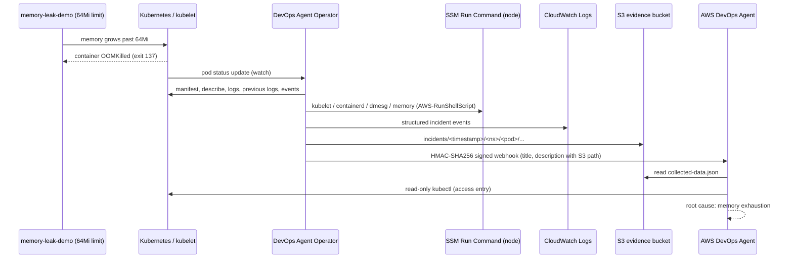

# Architecture (V1)

V1 proves one workflow: **DETECT -> COLLECT -> INVESTIGATE -> EXPLAIN**. There is no remediation.

## Components

| Component | Purpose |
|---|---|
| VPC (2 AZ, shared NAT) | Private subnets for nodes, public subnets for NAT / future load balancers |
| EKS + managed node group (t3.medium, On-Demand) | Runs the Operator and the demo; EC2 nodes are required for SSM node evidence |
| EKS Pod Identity agent | Gives pods their own short-lived IAM credentials |
| CloudWatch Observability add-on | Container Insights metrics and container logs the Agent can correlate |
| Operator (upstream AWS sample, pinned) | Detects failures, collects evidence, calls the webhook |
| S3 evidence bucket | Private, encrypted, 14-day expiry |
| CloudWatch log group `/ai-k8s-ops/devops-agent/incidents` | One log stream per incident |
| AWS DevOps Agent (manual setup) | Receives the webhook and investigates |

## Why the Operator is pinned to commit 6bfdfbc

Upstream `main` (commit `d577804` onward) fails to compile: `internal/config/config.go` references an undefined variable `failureType`, and `ShouldSendWebhook` is called with three arguments but defined with two. `6bfdfbc0a5b3db43f6b554e03b4b26780c539fe3` is the last commit that builds (verified with Go 1.25). It lacks only the optional `WEBHOOK_EXCLUDE_TYPES` filter, which V1 does not use. Re-test when upstream fixes `main` and bump `OPERATOR_COMMIT` in `scripts/lib.sh`.

## Differences from the upstream example manifests

- The ClusterRole is read-only; pod `patch` (used for the "processed" annotation) and `pods/log` are granted by a Role in `reliability-lab` only. Leader-election lease permissions are a Role in the Operator's own namespace. The unused `jobs` permission is dropped.
- The webhook URL and secret both come from a Kubernetes Secret created at deploy time; nothing is a literal in YAML.
- Upstream example sets `CONTAINER_CREATING_TIMEOUT`, which the code at this commit does not read; the real variable is `FAILURE_GRACE_PERIOD` (default 3m), so it is left at its default.

## Behaviour to know

- The Operator ignores pod *create* events and reacts to status *updates*, so deploy it before the demo (the scripts do).
- Dedup: a processed pod is annotated and skipped for `PROCESSED_TTL` (1h). To re-trigger sooner, run `./scripts/test-oom.sh restart` (new pod, new name).
- The Operator may also report `CrashLoopBackOff` for the same pod as restarts accumulate; the OOM incident arrives first.

## Build-time note

The optional temporary EC2 build server documented in `EC2_BUILD_SERVER.md` is not part of the runtime architecture. It exists only to compile/push the pinned Operator image when a local environment (for example CloudShell) does not have enough Docker build storage. EKS always pulls the final image directly from ECR.

## Deviations from the requested layout

- Added `terraform/devops_agent.tf` (optional Agent Space role wiring) and `scripts/lib.sh` (shared helpers).
- Kubernetes manifests with variables use a `.tpl` suffix and are rendered with `envsubst` by the scripts; static manifests are plain YAML. No Helm/Kustomize in V1.
