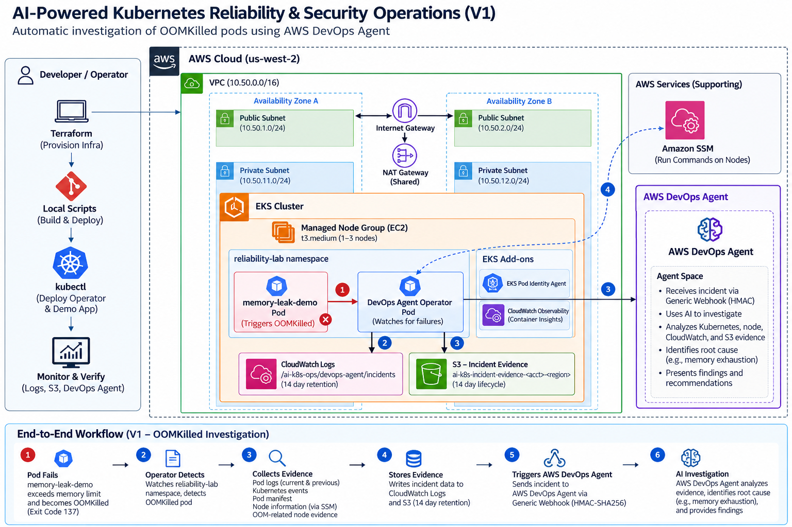

# AI-Powered Kubernetes Reliability & Security Operations

AI-powered incident investigation for Amazon EKS. V1 deliberately creates an `OOMKilled` workload, detects it with the AWS DevOps Agent Operator, collects Kubernetes and node-level evidence, stores that evidence in CloudWatch Logs and S3, and triggers an AWS DevOps Agent investigation through an HMAC-signed webhook.

**V1 proves: DETECT -> COLLECT -> INVESTIGATE -> EXPLAIN.** It does not perform autonomous remediation.

## V1 architecture



The runtime architecture is intentionally small: a dedicated VPC, private EKS managed nodes, EKS Pod Identity, CloudWatch Observability, the DevOps Agent Operator, short-lived incident evidence, and AWS DevOps Agent. A temporary EC2 builder may be used to build the Operator image, but it is **not** part of the runtime architecture and should be terminated after the image is pushed to ECR.

## Choose your path

There are two ways to work through the same architecture:

### 1. Learn it manually

Use the AWS console and CLI to build the components in dependency order, observe why each resource exists, intentionally trigger the OOM failure, and verify the investigation chain.

**Guide:** [Manual build walkthrough](docs/MANUAL_BUILD.md)

### 2. Deploy it with code

Use Terraform for AWS infrastructure and the included scripts/manifests for image builds and Kubernetes deployment.

**Guide:** [IaC deployment flow](docs/IAC_DEPLOYMENT.md)

## V1 scenario

`memory-leak-demo` continuously allocates memory until it crosses its Kubernetes `64Mi` memory limit. The container is terminated with:

```text
Reason: OOMKilled
Exit Code: 137
```

The Operator then collects evidence including pod state, current/previous logs, Kubernetes events, kubelet/containerd output, `dmesg`, IPAMD/networking information, disk/inode usage, and node memory information. It writes evidence to CloudWatch Logs and S3 before calling the DevOps Agent generic webhook.

A successful investigation should identify the workload memory leak rather than treating the node or cluster as unhealthy.

## What gets created

- Dedicated VPC across two Availability Zones
- Two public and two private subnets
- Internet Gateway and one shared NAT Gateway by default
- EKS control plane with all five control-plane log types enabled
- EKS managed node group using private EC2 nodes
- EKS Pod Identity Agent
- Dedicated Pod Identity for the VPC CNI
- CloudWatch Observability add-on / Container Insights
- Dedicated Pod Identity role for the DevOps Agent Operator
- Two ECR repositories: Operator and demo application
- Private S3 incident-evidence bucket with 14-day lifecycle
- CloudWatch incident log group with 14-day retention
- Optional read-only EKS/evidence access for the AWS DevOps Agent Agent Space role

## Repository layout

```text
.
├── README.md
├── SECURITY.md
├── Makefile
├── apps/
│   └── memory-leak-demo/
├── docs/
│   ├── architecture/
│   │   └── aws-k8s-oomkilled-investigation-v1.png
│   ├── ARCHITECTURE.md
│   ├── AWS_DEVOPS_AGENT_SETUP.md
│   ├── EC2_BUILD_SERVER.md
│   ├── IAC_DEPLOYMENT.md
│   ├── MANUAL_BUILD.md
│   └── TESTING.md
├── kubernetes/
│   ├── apps/
│   ├── namespaces/
│   └── operator/
├── scripts/
│   ├── build-demo.sh
│   ├── build-operator.sh
│   ├── build-operator-ec2.sh
│   ├── configure-webhook.sh
│   ├── deploy.sh
│   ├── destroy.sh
│   ├── lib.sh
│   └── test-oom.sh
└── terraform/
    ├── devops_agent.tf
    ├── ecr.tf
    ├── eks.tf
    ├── iam.tf
    ├── locals.tf
    ├── observability.tf
    ├── outputs.tf
    ├── providers.tf
    ├── storage.tf
    ├── terraform.tfvars.example
    ├── variables.tf
    ├── versions.tf
    └── vpc.tf
```

## Fast IaC start

Prerequisites: AWS CLI v2, Terraform >= 1.9, kubectl, Git, Docker, and `envsubst`/gettext. For the Operator image, Docker can run locally or on the optional temporary EC2 build server.

```bash
cp terraform/terraform.tfvars.example terraform/terraform.tfvars
# Set admin_cidr and, once created, the DevOps Agent primary-source role ARN.

terraform -chdir=terraform init
terraform -chdir=terraform plan -out=tfplan
terraform -chdir=terraform apply tfplan

aws eks update-kubeconfig --region us-west-2 --name ai-k8s-ops-lab
```

Create the AWS DevOps Agent Agent Space and HMAC webhook as described in [AWS DevOps Agent setup](docs/AWS_DEVOPS_AGENT_SETUP.md), export the webhook URL/secret, then either run the individual scripts in the IaC guide or use:

```bash
make deploy
make watch
make verify
```

## Optional EC2 image builder

CloudShell can run out of Docker build storage while compiling the Go-based Operator. If that happens, use a small temporary Amazon Linux 2023 EC2 instance with an ECR-capable instance role, then run:

```bash
./scripts/build-operator-ec2.sh
```

The helper builds the same pinned Operator commit and pushes the same deterministic image tag expected by the normal deployment scripts. See [Temporary EC2 build server](docs/EC2_BUILD_SERVER.md).

## Security model

V1 is intentionally investigation-first. The AWS DevOps Agent receives read-only EKS access through `AmazonAIOpsAssistantPolicy`. The Operator can write only the incident evidence it generates and can use SSM Run Command for node-level collection. For this disposable lab, `ssm:SendCommand` is allowed against EC2 instances in the account/region rather than being conditioned on an instance tag; the fixed upstream collection commands and the short-lived lab boundary are the compensating constraints. See [SECURITY.md](SECURITY.md).

## Cost and cleanup

The main cost drivers are the EKS control plane, EC2 worker nodes, NAT Gateway, Container Insights, and AWS DevOps Agent usage. Destroy the lab when finished:

```bash
make destroy
```

ECR repositories and the evidence bucket are configured so retained lab images/evidence do not block Terraform destruction. Delete the DevOps Agent Agent Space/webhook separately if no longer needed, because those are created manually.

## Future work — not implemented in V1

- CrashLoopBackOff and ImagePullBackOff investigations
- Node failure scenarios
- ALB / Ingress failures
- Pod Identity / IAM failure scenarios
- Kubernetes security findings
- ArgoCD and GitOps
- AI remediation proposals
- Human approval
- Rollback / Git revert
- Post-remediation verification
- Automated post-mortems

The upstream Operator is AWS sample code and is not copied into this repository; the build scripts fetch a pinned upstream commit at build time.
